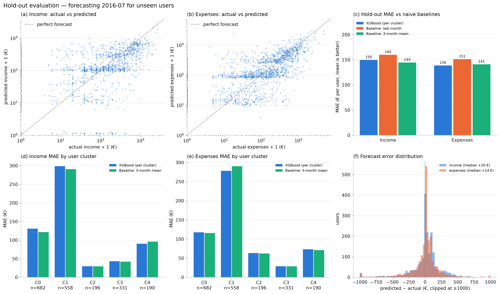
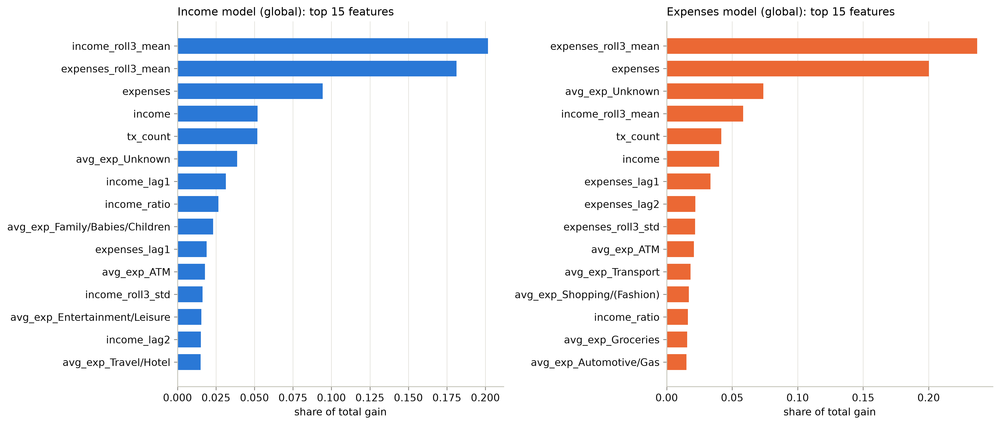

# Income & Expenses Forecasting

[](https://github.com/aadinoyiibrahim/income/actions/workflows/release.yml)

Forecasts each user's **next-month income and expenses**, with a category breakdown, from their bank
transaction history. The model is an XGBoost regressor per user cluster (K-means), and it is served as a FastAPI service.

The data covers 408,546 transactions from 10,000 users, Feb–Jul 2016. The shipped model forecasts **August 2016**.

```
src/            pipeline package (the CLI, API and notebook all use it)
  config.py       paths (env-overridable) and column names
  preprocessing.py  load, validate, user×month panel, lag/rolling features
  cluster.py      K-means user segments
  train_model.py  hold-out evaluation + final fit (Optuna-tuned XGBoost)
  predict.py      next-month forecasts + category breakdowns
  evaluate.py     metrics, naive baselines, bootstrap CIs
  plotter.py, eda.py   figures
  api.py          FastAPI app
  cli.py          `income` command
data/           raw CSVs and lookups; data/examples/sample_users.csv = 20 real users
models/         model_bundle.joblib (the one artifact the API needs)
notebooks/      analysis.ipynb (+ build_notebook.py, which generates it)
tests/          pytest; runs in temp dirs and never touches data/ or models/
```

## Quick start

All three ways serve the same API. After starting it, open **http://localhost:8000/docs** (`/` redirects there). Click `POST /predict` → *Try it out*, upload `data/examples/sample_users.csv`, and click *Execute*.

### 1. From the deployed image (no clone needed)

Every push to `main` publishes `ghcr.io/aadinoyiibrahim/income`:

```bash
docker run -p 8000:8000 ghcr.io/aadinoyiibrahim/income:latest
```

### 2. Locally with uv

```bash
git clone https://github.com/aadinoyiibrahim/income.git && cd income
uv sync --all-extras          # creates .venv from uv.lock (Python ≥3.11)
uv run income serve           # API on http://127.0.0.1:8000
```

### 3. Locally with Docker

```bash
docker compose up --build     # or: docker build -t income . && docker run -p 8000:8000 income
```

### Call the API

```bash
curl -F "file=@data/examples/sample_users.csv" http://localhost:8000/predict
```

```json
{
  "forecast_month": "2016-08",
  "model_version": "2026-11-01T20:25:37+00:00",
  "n_users": 20,
  "predictions": [
    {
      "user_id": "000aa792d73dd82b16a29692772d395a",
      "cluster": 0,
      "predicted_income": 142.0,
      "predicted_expenses": 175.0,
      "predicted_income_breakdown": {"Unknown": 142.01},
      "predicted_expenses_breakdown": {"Home and DIY, House Energy": 49.84, "Unknown": 125.19}
    }
  ]
}
```

* **Input:** a CSV with `user_id, transaction_date, transaction_type, amount_n26_currency` (`mcc_group` optional).
  It needs at least one *complete* month per user. The forecast is for the month after the last month in the file.
* **Other endpoints:** `GET /health` (liveness, and whether the model is loaded) and `GET /model` (version and hold-out metrics).
* **Config (env vars):** `PORT` (8000), `WEB_CONCURRENCY` (2 workers), `INCOME_MODEL_PATH`, `INCOME_MAX_UPLOAD_MB` (100).

## Pipeline (CLI)

```bash
uv run income train              # hold-out evaluation, then final fit -> models/, results/metrics.json (~4 min)
uv run income train --trials 0   # skip Optuna, default hyper-parameters (~30 s)
uv run income predict --input data/2016-09-19_79351_training.csv   # -> results/predictions_2016-08.csv
uv run income report             # figures -> img/
uv run income eda                # EDA figure -> img/eda/, stats to stdout
```

Training is leakage-free:
1. Split **users** 80/20.
2. Fit on the training users using Feb–Jun only.
3. Forecast **July** for the held-out users and compare with what actually happened.
4. Refit on all users and months, so the saved model forecasts August.

## Notebook

```bash
uv sync --all-extras
uv run jupyter lab notebooks/analysis.ipynb
```

`RETRAIN = False` (default) loads the saved model and finishes in about 30 s. Set `RETRAIN = True` to re-run
training inside the notebook. To edit cells, change `notebooks/build_notebook.py`, then run
`uv run python notebooks/build_notebook.py && uv run jupyter nbconvert --to notebook --execute --inplace notebooks/analysis.ipynb`.

## Results (July 2016 hold-out, 1,957 unseen users)

| Target   | Method                 | MAE (€) | RMSE (€) | R²    |
|----------|------------------------|--------:|---------:|------:|
| Income   | **XGBoost**            | 149.8   | **251.5** | **0.36** |
|          | last month             | 159.9   | 314.9    | −0.01 |
|          | 3-month mean           | **144.6** | 261.1  | 0.31  |
| Expenses | **XGBoost**            | **138.7** | **266.1** | **0.54** |
|          | last month             | 151.3   | 337.5    | 0.26  |
|          | 3-month mean           | 141.0   | 277.1    | 0.50  |

How to read this:
* The model beats both naive baselines on RMSE and R². Its MAE is **not** clearly better than a 3-month mean.
  On expenses the difference is −2.4 € (paired-bootstrap 95% CI −8.0 to +3.3). On income the model is
  worse by 5.2 € (CI +0.1 to +10.1).
* This is expected. The model minimises squared error, so it predicts the conditional *mean*. MAE rewards the
  *median*, and for lumpy incomes (salary or nothing) the median is often 0.
* Only one month is held out, so treat these numbers as indicative.




## Development

```bash
uv sync --all-extras
uv run pytest                    # 19 tests
uv run ruff check src tests && uv run ruff format src tests
```

**CI/CD (GitHub Actions)**
* `ci.yml` runs on pull requests: ruff, then pytest on Python 3.11/3.12, then a Docker build plus a smoke
  test (`/health` and a real `/predict` call).
* `release.yml` runs on pushes to `main` and on `v*` tags. It runs CI, pushes `ghcr.io/<owner>/<repo>`
  (tagged `latest`, `sha-…` and the semver), then calls `DEPLOY_WEBHOOK_URL` if that repository secret is set.
  This works with Render, Railway, Coolify, Portainer and similar hosts. On a plain VM, run
  `docker pull ghcr.io/aadinoyiibrahim/income:latest && docker compose up -d`.
* After the first publish, set the package to *public* in GitHub → Packages, if you want pulls without logging in.

## Contact

[aadinoyiibrahim](https://github.com/aadinoyiibrahim) · MIT License
