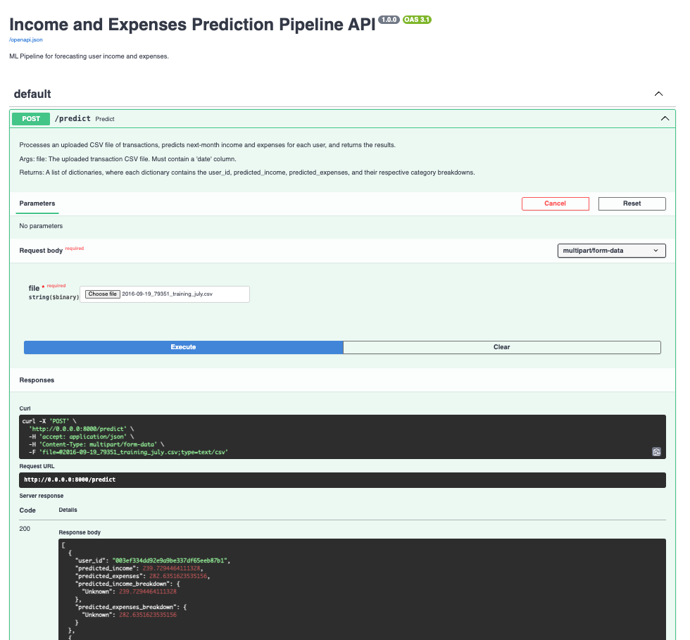
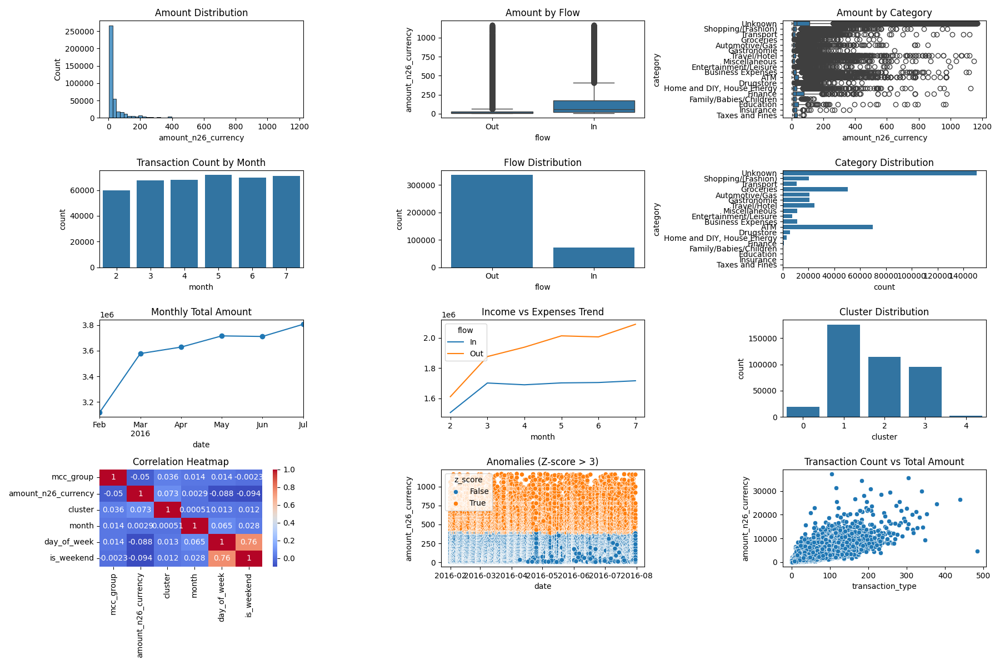
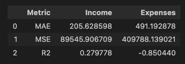
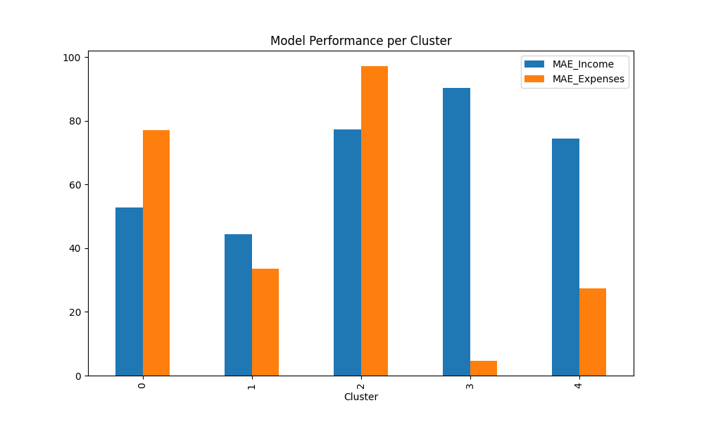
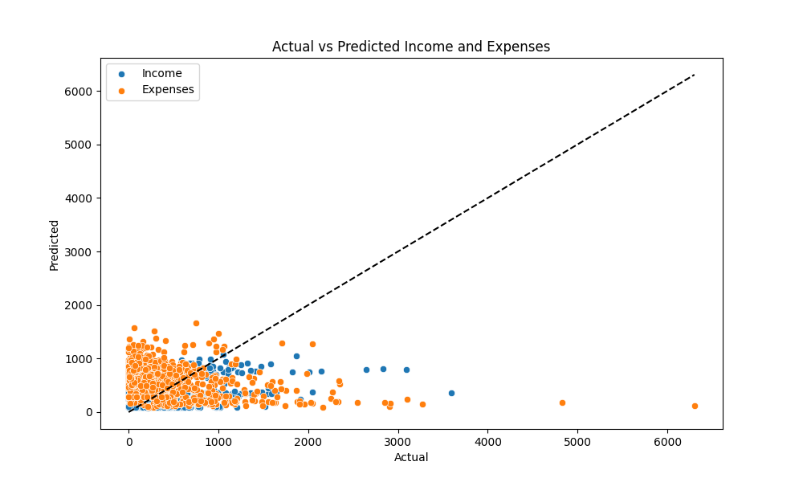
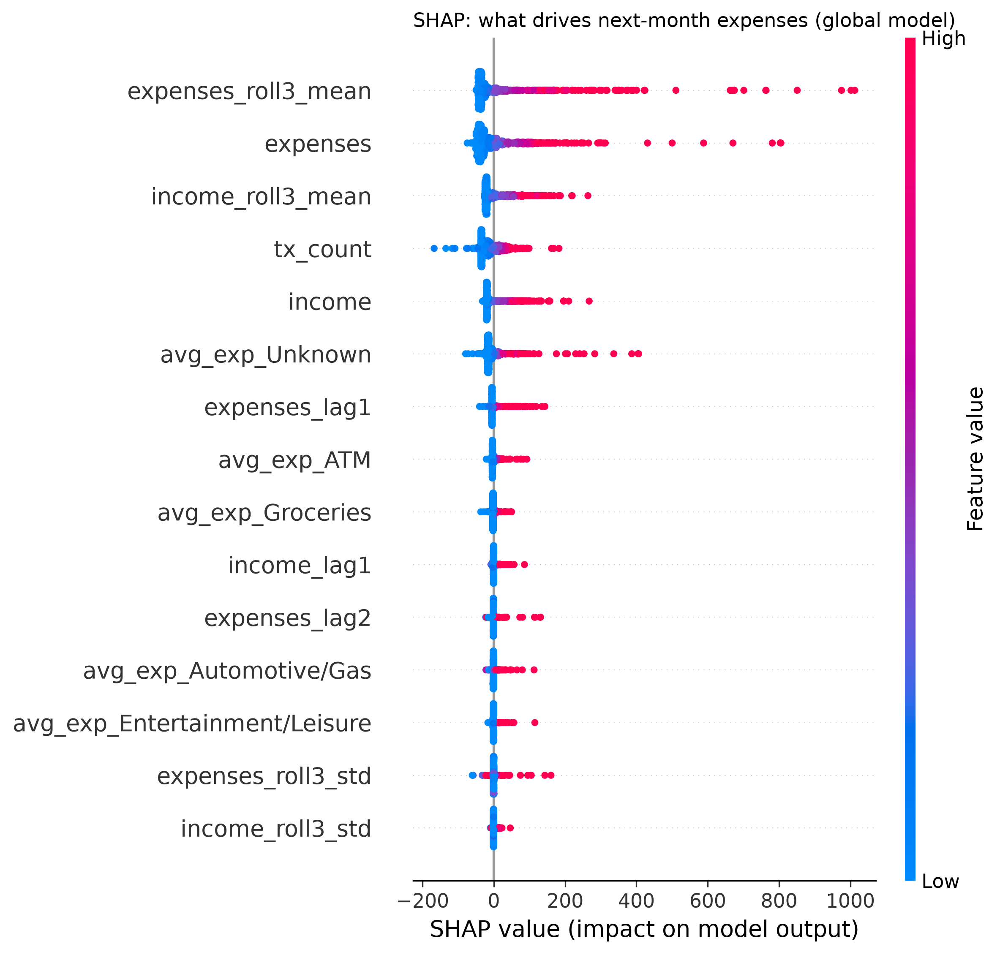

# Income and Expenses Prediction Pipeline

This project deploys a machine learning pipeline to forecast users' next-month income and expenses, including category-level breakdowns, based on historical financial transactions.

## goal

The task is to predict total incoming and outgoing flows (income and expenses) for a holdout sample of users for August 2016 (based on training data from February to July 2016).

## what's included

This repository is structured to support both local development/runs and Docker deployment:

- `src/`: source code for the pipeline
-  - `analysis.ipynb`: main notebook for all analysis and prediction.
-  - `eda.py`: exploratory data analysis module.
-  - `preprocessing.py`: data cleaning and feature engineering.
-  - `cluster.py`: user clustering with K-means.
-  - `train_model.py`: model training with XGBoost and Optuna.
-  - `predict.py`: prediction and aggregation.
-  - `plotter.py`: metrics and feature importance plots.
-  - `api.py`: FastAPI for deployment.
- `data/`: the raw transaction data and lookup files.
- `models/`: saved models and scaler.
- `result/`: output dir for saved predictions.
- `img/`: dir for plots from EDA and metrics.
- `requirements.txt`: dependencies.
- `Dockerfile`: containerized environment for the FastAPI.
- `README.md`: This file.

## How to run the code

We try using the Jupyter, terminal and app

### via Jupyter

clone this repo and install all required dependencies. In particular, this step can be executed as follow:

```bash
git clone [repository-url]
cd income-prediction-pipeline
pip install -r requirements.txt
```

Run `analysis.ipynb` for full pipeline. Open `src/analysis.ipynb` and run cells sequentially for EDA, clustering, training, prediction.
This will save predictions in `../result/predictions_all_models.csv`.

### via terminal

Run each pyscript as shown in the `analysis.ipynb` sequentially.

### via Docker
Assuming you have docker destop installed. Open the Docker Desktop application. Next, build the docker image by runing the following on your terminal

```bash
docker build -t income-predictor .
docker run -p 8000:8000 income-predictor
```

### via API usage

After running `docker run -p 8000:8000 income-predictor` on the terminal, open http://localhost:8000/docs on your browser. click on /predict > Try it out > upload your data (e.g., upload 2016-09-19_79351_training_july.csv) > execute > execute.

You'll see a json output per user, here is an example.

```bash
 {
    "user_id": "03f01986085ec123a18aa01877927ac5",
    "predicted_income": 107.13653564453125,
    "predicted_expenses": 886.4243774414062,
    "predicted_income_breakdown": {
      "Unknown": 107.13653564453125
    },
    "predicted_expenses_breakdown": {
      "ATM": 311.5277523435842,
      "Business Expenses": 115.88230401186466,
      "Drugstore": 25.584404781840245,
      "Gastronomie": 37.62412467917684,
      "Groceries": 67.7234244225183,
      "Shopping/(Fashion)": 234.77453799806347,
      "Transport": 10.534754910169513,
      "Unknown": 82.77307429418904
    }
  },
```
 You can download all user as a json file.

<p align="center" width=10%>
<br>
</p>


## EDA
<p align="center" width=10%>
<br>
</p>

## Metrics

We consider three metrics; MAE, MSE and R2.

<p align="center" width=10%>
<br>
</p>

<p align="center" width=10%>
<br>
</p>

<p align="center" width=10%>
<br>
</p>

<p align="center" width=10%>
<br>
</p>


## Contact
You can reachout here [aadinoyiibrahim](https://github.com/aadinoyiibrahim) and RA

## Appreciation

[](https://github.com/aadinoyiibrahim/income)

[](https://github.com/aadinoyiibrahim/income/stargazers)
